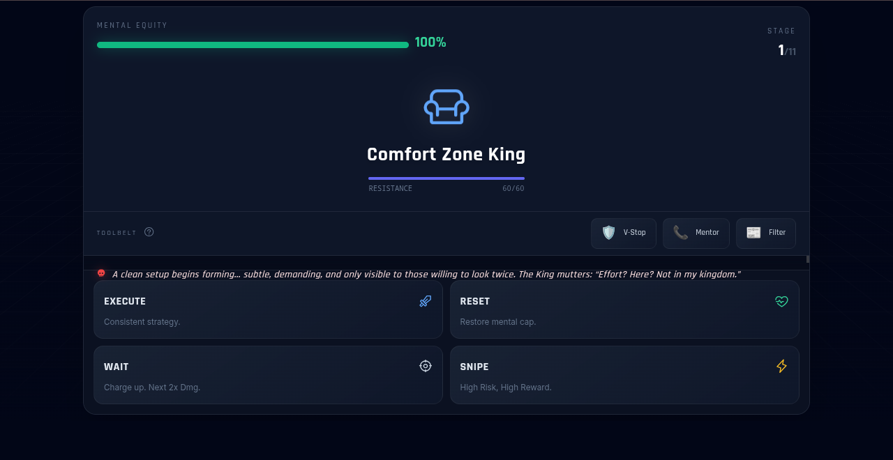

# Self Sabotage Slayer

**An interactive, turn-based browser RPG about trading psychology and overcoming self-sabotage.** Battle 11 bosses, manage your Mental Equity, adapt to changing market conditions, and choose upgrades as you advance.

**[Play Self Sabotage Slayer](https://self-sabotage-slayer.com/)**

## Preview



<details>
<summary>View mobile gameplay</summary>


</details>

## Gameplay

You face 11 bosses inspired by trading and decision-making pitfalls. Every encounter challenges you to balance damage, recovery, and risk while keeping your **Mental Equity** above zero.

**Combat actions:**

- **Execute:** A dependable attack.
- **Reset:** Recover Mental Equity, subject to a cooldown.
- **Wait:** Charge your next attack for double damage.
- **Snipe:** A high-risk attack with a chance of a bigger hit or a miss.

**Additional systems:**

- **11 distinct bosses** with unique themes and attack behavior
- **Three limited-use tools:** Volatility Stop, Mentor Call, and News Filter
- **Market conditions** that modify combat (bullish, choppy, bearish, flash crash)
- **Trading Journal** upgrades offered as you progress
- **Responsive desktop/mobile layout**, fullscreen-fit option, sound effects, and victory animations

## Tech stack

- **HTML5** and **CSS3**
- **Vanilla JavaScript** for state management, turn-based combat, upgrades, and UI updates
- **Tailwind CSS**, loaded from its CDN at runtime
- **Phosphor Icons**, **Animate.css**, and **Google Fonts**, loaded from external CDNs
- **Web Audio API** for synthesized sound effects

GitHub recognizes the standalone `.html`, `.css`, and `.js` files as separate languages. A small Tailwind theme configuration remains in the HTML head so the CDN applies it before the game renders.

This is a **static, client-side project**. It has no server-side application, database, authentication, or build step. An internet connection is needed to load the external styling, icons, and font assets.

## Run locally

Keep all three source files in the same folder. Open `index.html` in a modern browser, or serve the folder locally:

```bash
python -m http.server 8000
```

Then visit `http://localhost:8000`.

## Project structure

```text
self-sabotage-slayer/
├── index.html                 # Game structure and Tailwind theme setup
├── style.css                  # Custom styling, animations, and responsive rules
├── game.js                    # Turn-based combat logic, state, events, and audio
├── docs/
│   ├── desktop-gameplay.png   # Desktop gameplay preview
│   └── mobile-gameplay.png    # Mobile gameplay preview
├── README.md                  # Project documentation
└── .gitignore                 # Keep local/generated files out of Git
```

## Notes

- This game uses trading-related themes for entertainment. It does not place trades or provide financial advice.
- Replit configuration, old development history, and unused project attachments are intentionally excluded from this standalone release.
- No license file has been selected for this repository. Publicly viewable code does not automatically grant permission to redistribute or republish it.
