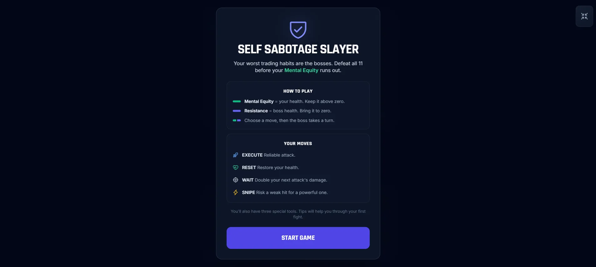
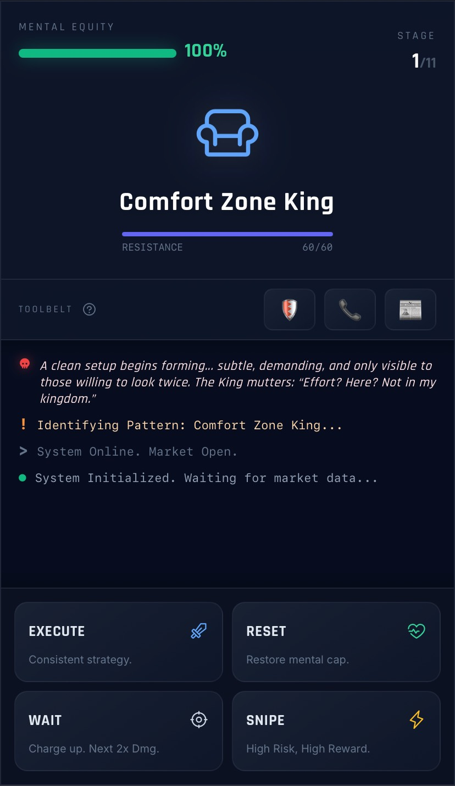

# Self Sabotage Slayer

**An interactive, turn-based browser RPG about trading psychology and overcoming self-sabotage.** Battle 11 bosses, manage your Mental Equity, adapt to changing market conditions, and choose upgrades as you advance.

**[Play Self Sabotage Slayer](https://mediumblue-oryx-440075.hostingersite.com/)**

## Preview



<details>
<summary>View mobile gameplay</summary>



</details>

## The idea

Trading is as much an emotional test as a technical one, so this game turns that rollercoaster into something you can play. Every boss is a habit traders fight, arranged to follow a trader's journey as I see it: from beginner habits like avoiding the charts to the overconfidence that can still wipe out an experienced account. It's meant to be fun and a little ridiculous, and to help players recognize a few of these patterns in themselves.

**The bosses, from new trader to mastery:**

1. Comfort Zone King
2. Paralysis Golem
3. FOMO Phantom
4. Doomscroll Demon
5. Revenge Raptor
6. Heartbreak Hedger
7. Clarity Crusher
8. Volatility Viper
9. Greed Goblin
10. Pride Pharaoh
11. Account Assassin

## Gameplay

You face 11 bosses inspired by trading and decision-making pitfalls. Every encounter challenges you to balance damage, recovery, and risk while keeping your **Mental Equity** above zero.

**Combat actions:**

- **Execute:** A reliable attack.
- **Reset:** Restore your Mental Equity. It needs a turn to recover.
- **Wait:** Double your next attack's damage. It needs 2 turns to recharge.
- **Snipe:** Risk a weak hit for a powerful one.

**Additional systems:**

- **11 distinct bosses** with unique themes and attack behavior
- **Three limited-use tools:** Volatility Stop, Mentor Call, and News Filter
- **Market conditions** that modify combat (bullish, choppy, bearish, flash crash)
- **Trading Journal** upgrades offered as you progress
- **Responsive desktop/mobile layout**, fullscreen-fit option, sound effects, and victory animations

## How the game works

Each turn runs through the same loop in `game.js`, driven by one shared `gameState` object:

1. **Player move.** `playerAction()` checks that it's the player's turn and that the move isn't on cooldown, then locks the controls so a turn can't be played twice.
2. **Damage and effects.** The move's damage or healing is calculated from the current level, the market condition, any upgrades, and WAIT's charge, then applied to the boss or the player.
3. **Win check.** If the boss's Resistance hits zero, `levelComplete()` restores 10% Mental Equity and moves to the next stage, or plays the victory sequence after the final boss.
4. **Boss turn.** Otherwise `bossTurn()` counts down cooldowns, picks one of the boss's attacks, and applies market effects and any active tools such as Volatility Stop.
5. **Loss check and UI.** If Mental Equity hits zero, the run ends. If not, the bars, buttons, battle log, and first-run tips update, and control returns to the player.

Between some stages, `showUpgradeSelection()` offers a choice of two upgrades. Then `loadLevel()` sets up the next boss and its market condition.

## How it changed after playtesting

1. **Clearer rules.** A How to Play screen now explains Mental Equity, boss Resistance, and each move before the first fight, with short tips during the first battles.
2. **Too hard at first.** Friends who played early versions found it too difficult, so I added the toolbelt and adjusted health.
3. **Then too easy.** After those changes it was possible to win without using the tools, so I rebalanced:
   - Player health raised from 100 to 150, so each hit takes a smaller share of the bar.
   - RESET now needs a turn to recover after use. The cooldown clears between boss fights.
   - RESET healing scales with level × 1.0 (was × 1.5), and EXECUTE damage with level × 2.0 (was × 2.5).
   - Boss damage climbs more steadily across the campaign, from 12–17 per hit at the first boss to 30–60 at the last.

<details>
<summary>Boss damage by stage</summary>

| Stage | Boss | Damage per hit |
|---|---|---|
| 1 | Comfort Zone King | 12–17 |
| 2 | Paralysis Golem | 13–19 |
| 3 | FOMO Phantom | 14–21 |
| 4 | Doomscroll Demon | 15–24 |
| 5 | Revenge Raptor | 16–27 |
| 6 | Heartbreak Hedger | 18–28 |
| 7 | Clarity Crusher | 19–28 |
| 8 | Volatility Viper | 21–33 |
| 9 | Greed Goblin | 26–41 |
| 10 | Pride Pharaoh | 27–42 |
| 11 | Account Assassin | 30–60 |

</details>

The game was finished and first deployed on Replit.

## Tech stack

- **HTML5** and **CSS3**
- **Vanilla JavaScript** for state management, turn-based combat, upgrades, and UI updates
- **Tailwind CSS**, loaded from its CDN at runtime
- **Phosphor Icons**, **Animate.css**, and **Google Fonts**, loaded from external CDNs
- **Web Audio API** for synthesized sound effects

GitHub recognizes the standalone `.html`, `.css`, and `.js` files as separate languages. A small Tailwind theme configuration remains in the HTML head so the CDN applies it before the game renders.

This is a **static, client-side project**. It has no server-side application, database, authentication, or build step. An internet connection is needed to load the external styling, icons, and font assets.

## Run locally

Keep all three source files in the same folder. Open `index.html` in a modern browser, or serve the folder locally:

```bash
python -m http.server 8000
```

Then visit `http://localhost:8000`.

## Project structure

```text
self-sabotage-slayer/
├── index.html                 # Game structure and Tailwind theme setup
├── style.css                  # Custom styling, animations, and responsive rules
├── game.js                    # Turn-based combat logic, state, events, and audio
├── docs/
│   ├── desktop-gameplay.png   # Desktop gameplay preview
│   └── mobile-gameplay.png    # Mobile gameplay preview
├── README.md                  # Project documentation
└── .gitignore                 # Keep local/generated files out of Git
```

## Notes

- This game uses trading-related themes for entertainment. It does not place trades or provide financial advice.
- Replit configuration, old development history, and unused project attachments are intentionally excluded from this standalone release.
- No license file has been selected for this repository. Publicly viewable code does not automatically grant permission to redistribute or republish it.
